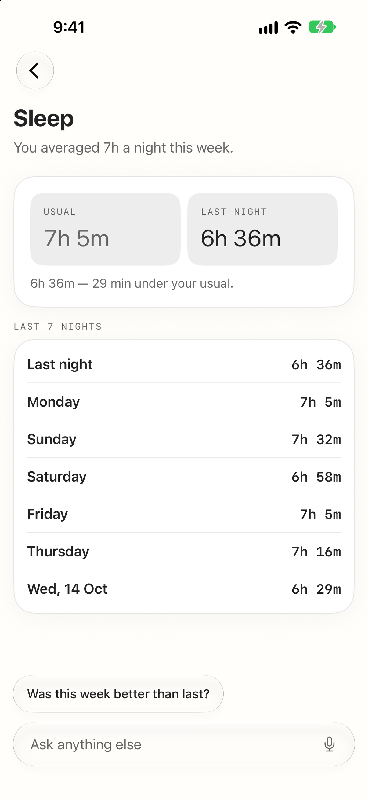

# pocketd

[](https://github.com/dheerajjha/pocketd/actions/workflows/ci.yml)
[](LICENSE)
[](Package.swift)
[](project.yml)

`pocketd` is an assistant that lives on your iPhone. It reads your calendar,
your reminders and your health data on the device, and writes you a short
brief each morning — a paragraph about your actual day, not a dashboard. Ask
it what's next, what's overdue, or how you slept, by typing, by holding the
mic button, or from Control Center. Tell it to set a reminder or add an event
and it does. Nothing you say and nothing it reads ever leaves the phone.


Today is the app's one home, and there is no tab bar. Four tiles under the
brief — Up next, Due, Sleep and Activity — each lead with a verdict, "Rested",
"1 overdue", "Ahead", and one plain sentence that carries the number against
your own usual rather than a national average. Tap a tile and you get its
page, read straight from Calendar, Reminders or Health rather than written by
the model: your day as now, later today and tomorrow, with directions and a
link into Calendar; your reminders, ticked off with a tap and an Undo; last
night's sleep or today's steps beside your usual, and the last seven days. A
tile for something you haven't connected says "Off", and tapping it asks iOS
right there, or opens Settings if iOS has already been told no. Routines and
You are one tap away in the header, and one suggested question and a field to
ask anything sit at the bottom of Today and of every page under it. A Home
Screen and Lock Screen widget carries the same brief a tap away, with no need
to open the app at all.



## Ask

Ask is the conversation, and it opens as a sheet over wherever you are: from
the field at the bottom of Today or of a page, from the Ask Pocketd control in
Control Center, on the Lock Screen or on the Action Button, or from Siri. Type
a question, or hold the mic button and speak it; the mic on Today and on each
page opens the conversation already listening. Speech recognition runs on the
device — `requiresOnDeviceRecognition` is set once and never unset — so on a
phone or in a locale where that isn't available, the mic button hides itself
rather than quietly sending your voice to a server. An answer that touches
your calendar, reminders or health comes back as one card: a sentence, and
under it a timeline of events, a checklist of reminders you can tick off
without leaving the card, or a small grid of health numbers. A reminder or an
event it adds comes with an Undo that lasts five minutes. Stop stops, at once,
and the reply says "Stopped." If a question needs a source that's switched
off, the conversation offers to connect it right there rather than answering
as though it doesn't exist. History keeps every conversation, to reopen,
rename or delete.


## Routines

Routines are what runs on its own, behind the ⏰ in Today's header. Each one
is a card laid out like an alarm: the time, large; the days and what it does
in one grey line; a switch; and a line of what it last told you, which opens
in full. "+" adds a Morning brief, an Evening wrap-up, an Overdue nudge or a
Weekly review with one tap, at a sensible time, or starts a Custom routine of
your own; the Evening wrap-up, the Weekly review and Custom are part of
Pocketd Pro. Tap a card to change its time, its days or its name.

There is one kind of brief. The Morning brief and the Evening wrap-up are
Today's brief arriving at the hour you chose: a notification says "Your
morning brief is ready.", with one sentence about the day when a background
refresh got to read it — titles left out, because a Lock Screen is read by
whoever holds the phone — and tapping it opens Today, where the brief is
written. A check like the Overdue nudge needs no model and no GPU: it's a
deterministic read over your reminders that can run to completion in the
background, so it still fires days after you last opened the app. A routine
that asks the brain a question, like the Weekly review, can only be answered
while Pocketd is open, so the answer is written the next time you open it.


## You

You, behind your avatar in Today's header, is one short page. At the top is
what Pocketd can see — Calendar, Reminders, Health, each its own row and its
own switch, and the switch is what asks iOS. Then one row each for its brain,
for privacy, and for using it from your laptop (the same server pocketd has
always run, below), each saying its state in a line, with the detail one
level down. About holds Pocketd Pro, Rate Pocketd, the privacy policy and
Replay intro; Advanced holds the assistant's instructions, server settings and
diagnostics. Privacy is promises first — only you can see your data, nothing
you ask is sent anywhere, other devices can't read your calendar, reminders or
health — with the proof one level down, walking the container and accounting
for every byte in it.


## First run

First run is five screens, with no Skip. **Meet Pocketd** says what it
promises — no account, nothing you ask leaves this phone, works with no
signal — and that it counts anonymous app usage, with where to turn that off.
**Choose how Pocketd thinks** offers Built into iPhone, recommended where
Apple Intelligence is on, or the one private download sized for this phone,
which starts downloading when you continue; a phone without Apple Intelligence
sees only the download. **Connect your day** has Calendar, Reminders and
Health on one screen, each optional, each asked for only when you tap its row,
with a line naming the button iOS is about to show. **Get your day every
morning** sets a morning brief for weekdays — 7:30 unless you pick another
time — with an example notification written from your own day. **You're all
set** ticks off what is connected and asks, if you like, what to call you. A
brain already on the phone is never downloaded again, and anything you skip is
offered again later by the tile that needs it.


## Two brains

Pocketd thinks with one of two brains, and you choose. Brain, under You,
switches between them at any time.

- **Built into iPhone** is Apple's on-device model, reached through the
  FoundationModels framework. There is nothing to download. It needs iOS 26 or
  later on an iPhone that supports Apple Intelligence, with Apple Intelligence
  turned on, and where it's available it is the default on a fresh install.
- **Private download** is one recommended GGUF model, run by llama.cpp:
  Qwen3 1.7B at 1.11 GB, picked because it can read your day and fits the
  phone. It works with Apple Intelligence on or off, on any iPhone with room
  for it, and once it's downloaded it needs no signal.

Both run the same three tools against Calendar, Reminders and Health, so
either one can read your day and add to it. A brain that can't call tools
can't read your calendar, so it is never recommended and never writes the
brief; the brief falls back to a template built from the same data. More
brains, under Brain, lists the rest of the catalogue and a search across
Hugging Face, each brain marked "Reads your day" or "Chat only".

The server for your laptop only ever serves downloaded GGUF brains. Apple's
model answers the phone's own questions and is never exposed over HTTP; a
phone that uses the built-in brain is offered the recommended download for
other devices.

## Pocketd Pro

Pocketd is MIT-licensed, and building it from this repository gets you
everything, Pro included. Pro is a handful of gates in the app, all of them in
this source tree, and there is no Pocketd server deciding anything. A Debug
build run from Xcode unlocks it with a test purchase from the scheme's StoreKit
file, which charges nothing, or launch one with `-pocketd.proOverride on`; in
a build of your own you're free to take the gates out.

On the App Store, Pocketd Pro is a one-time in-app purchase, with no
subscription and no account, and it is how this project is funded. It
unlocks three things:

- **Use from your laptop** — the server on your Wi-Fi, pairing and desk mode.
- **Every routine** — the Evening wrap-up, the Weekly review and Custom
  routines.
- **Any brain** — downloading brains beyond the recommended one, and
  searching Hugging Face for more.

Everything else is free: Today and its pages, the brief, the conversation with
either brain, the widgets, Siri and Control Center, the Morning brief and the
Overdue nudge, and any brain already on the phone. Anyone who installed
Pocketd from the App Store before 1.1.0 gets Pro free; the server was free
when they installed it, and they keep it. Restore purchase is in You › About.

## Why this exists

Every local-LLM app for iOS is a chat window. The model is right there, running
on hardware you own, and it can only be reached by the app that loaded it. The
most-requested feature on the leading open-source iOS client has been an HTTP
endpoint since [2024](https://github.com/a-ghorbani/pocketpal-ai/issues/203) and
is still open. The App Store option that does expose one is built on Apple
Intelligence, so it needs an iPhone 15 Pro or newer and refuses to run on
anything older.

`pocketd` is the other approach: llama.cpp, GGUF weights, and a real HTTP
server, on any device that can run iOS 18. It uses Apple's model too now, for
the phone's own answers where there is one, but the server always runs the
downloaded brain, so it works the same on a phone Apple Intelligence never
reached.

## Install

Requires Xcode 26 and [XcodeGen](https://github.com/yonaskolb/XcodeGen)
(`brew install xcodegen`). The `.xcodeproj` is generated, not committed.

```bash
git clone https://github.com/dheerajjha/pocketd
cd pocketd
make app          # generates Pocketd.xcodeproj
open Pocketd.xcodeproj
```

Set your team in Signing & Capabilities, then run on a device. A free Apple
developer account works; the provisioning profile expires after seven days and
you re-sign.

## Also, a server for your laptop

`pocketd` turns an iPhone into an inference server too. Download a brain, turn
on Allow other devices under You › Other devices, and every device on your
Wi-Fi can talk to it through the OpenAI and Ollama APIs they already speak — no
account, and not one prompt or reply leaving your network. Turning it on is
part of Pocketd Pro.

```bash
curl http://192.168.1.42:11434/v1/chat/completions \
  -H "Content-Type: application/json" \
  -H "Authorization: Bearer pk-…" \
  -d '{"model":"qwen3-1.7b","messages":[{"role":"user","content":"hello"}]}'
```

That is a phone answering. The port is Ollama's default on purpose: a client
already pointed at a desktop Ollama needs its host changed and nothing else.


## Chat from your laptop, with nothing installed

The phone already runs a web server, so it serves the client too. Open its
address in a browser and you get a chat window — streaming, model picker,
system prompt, stop button, history kept locally, a speed readout per reply.
No Docker, no account, no extension.

The page asks once for the six digits shown on the phone and remembers the key.
`/setup` has the same handshake and hands back ready-to-paste configs for curl,
Continue, opencode, the OpenAI SDKs for Python and JavaScript, Open WebUI and
Aider.

## It can see

Load a vision model and send it a picture — from the chat page, as an OpenAI
`image_url` content part carrying a base64 `data:` URI, or in Ollama's
`images` array on `/api/chat`. The page's attach button only works for a
model that can actually see; in its model picker, those are marked `◉`.

Verified on a physical iPhone 14: a solid green image comes back "Green.", a
solid yellow one "Yellow." — a control run, because a half-red-half-blue image
answered "Blue." and one colour out of two proves nothing on its own.

## What you can point at it

| Client | Works via | Configuration |
| --- | --- | --- |
| `curl`, `httpie` | OpenAI | Base URL + bearer token |
| OpenAI Python/JS SDK | OpenAI | `base_url="http://<phone>:11434/v1"` |
| Open WebUI | Ollama | Add an Ollama connection |
| Continue, Cline, Aider | OpenAI | Custom provider, any model id from `/v1/models` |
| LangChain, LlamaIndex | OpenAI | `ChatOpenAI(base_url=…)` |
| Anything Ollama-shaped | Ollama | Change the host, keep the port |

## API

| Endpoint | Dialect | Notes |
| --- | --- | --- |
| `GET /v1/models` | OpenAI | Installed models, not the whole catalogue |
| `GET /v1/models/{id}` | OpenAI | One installed model |
| `POST /v1/chat/completions` | OpenAI | `stream: true` yields SSE, terminated by `[DONE]` |
| `POST /v1/completions` | OpenAI | Lifted into a single user turn |
| `GET /api/tags` | Ollama | |
| `POST /api/chat` | Ollama | Streams NDJSON, and streams **by default** |
| `POST /api/generate` | Ollama | Streams by default too |
| `POST /api/show` | Ollama | |
| `GET /api/ps` | Ollama | The model in memory |
| `GET /api/version` | Ollama | Clients version-gate on this |
| `POST /api/pull` | Ollama | Pull a catalogue model onto the phone, streaming progress |
| `GET /api/catalogue` | — | What could be pulled, versus what is installed |
| `GET /api/search?q=` | — | Search Hugging Face for GGUF repositories |
| `GET /api/search/files?repo=` | — | Files in a repository, with real sizes and a fit verdict |
| `POST /api/models/add` | — | Pull any Hugging Face GGUF, not just a catalogue entry |
| `POST /v1/embeddings`, `/api/embed`, `/api/embeddings` | — | `501`, so a client falls back instead of doubting its base URL |
| `GET /chat` | — | The browser chat page; a browser at `/` gets it too |
| `GET /setup` | — | Pairing, then ready-to-paste client configs |
| `POST /pair` | — | Trades the six-digit code for the key |
| `GET /health` | — | Unauthenticated, so a client can probe reachability |

Requests are authenticated with `Authorization: Bearer <key>` or `X-API-Key`;
`/health`, `/api/version`, the two pages and `/pair` answer without one.
Errors come back in the dialect you asked in: OpenAI's nested `{"error":{…}}`
or Ollama's flat `{"error":"…"}`, because a client fed the wrong one reports
"unknown error" and hides the reason.

## Desk mode

Desk mode is on the Use from your laptop page while the server is running. The
honest instruction is to keep the app on screen, which otherwise means an
iPhone at full brightness for hours. Desk mode dims to what is worth reading
across a desk and drifts it slowly so no pixel holds a colour — and because the
display draws from the same thermal budget as the GPU, a dark screen is worth
real tokens per second on a device already close to throttling.

## Any model, searched from your laptop

The catalogue is eight models known to load on a phone, and the app recommends
one of them. That is the right default and the wrong ceiling, so More brains,
under Brain, can search Hugging Face, show every GGUF in a repository with its
real byte size and whether it fits *this* device, and pull it. A file that
cannot fit says "Too big for this iPhone" instead of offering a button. Like
the server, this is part of Pocketd Pro.

The searching happens over HTTP as well as in the app, which no other local-LLM
iOS app can offer because none of them is a server. Choosing a model means
typing a repository name and comparing quantisations — that is laptop work, and
doing it on a phone keyboard is the reason nobody does it twice.

```bash
curl "http://192.168.1.31:11434/api/search?q=smollm" -H "Authorization: Bearer pk-…"
curl "http://192.168.1.31:11434/api/search/files?repo=ggml-org/SmolVLM-500M-Instruct-GGUF" -H …
#   SmolVLM-500M-Instruct-Q8_0.gguf   436.8 MB  Q8_0  comfortable
#   mmproj-SmolVLM-500M-Instruct-Q8_0.gguf  108.8 MB  projector

curl -X POST http://192.168.1.31:11434/api/models/add -H … \
  -d '{"repo":"unsloth/SmolLM2-135M-Instruct-GGUF","filename":"SmolLM2-135M-Instruct-Q4_K_M.gguf"}'
```

A vision model's projector is paired automatically, because one downloaded
without it loads and then cannot see — which is the confusing failure rather
than the obvious one.

## Which models actually fit

An iPhone 14 has 6 GB of RAM and iOS lets one app touch roughly 45% of it —
about 58% with the `com.apple.developer.kernel.increased-memory-limit`
entitlement this app ships. More brains labels every model against that
budget — "Fits well", "Tight fit" or "Too big for this iPhone" — and will not
download one that is too big, rather than letting you find out after 2 GB of
bandwidth.

Every size below is the catalogue's own, and `scripts/verify-catalogue.sh`
checks each weights file against its real `Content-Length` (to within 10%),
rather than trusting a number inferred from the parameter count.

The badge is that arithmetic — RAM times the fraction, raised only once a
model has actually loaded on this phone — so it does not move while you use
the app. It deliberately ignores how much memory is free at this instant,
because that number falls by the size of whatever is loaded: a verdict
computed from it labelled the running model too large to run. In the
simulator, where the numbers would otherwise describe your Mac, every brain is
judged the way an 8 GB iPhone would judge it — the same verdicts as the
iPhone 16 Pro column below — and Technical details, under More brains, says so.

| Model | File | iPhone 14 (6 GB) | iPhone 16 Pro (8 GB) |
| --- | --- | --- | --- |
| SmolLM2 360M | 0.39 GB | Fits | Fits |
| SmolVLM 500M + projector | 0.55 GB | Fits | Fits |
| Llama 3.2 1B | 0.81 GB | Fits | Fits |
| Qwen3 1.7B | 1.11 GB | Fits | Fits |
| Llama 3.2 3B | 2.02 GB | Tight | Fits |
| Qwen3 4B | 2.50 GB | Needs the entitlement | Fits |
| Gemma 3 4B + projector | 3.34 GB | Too large | Tight |
| Gemma 4 E2B | 3.11 GB | Too large | Tight |

Gemma 4 E2B is the one that catches people out, and it caught me out. "E2B"
means two billion *effective* parameters — that describes the compute, not the
weights. It is a MatFormer, the file carries the full nested model, and Q4_K_M
is 3.1 GB rather than the ~1.8 GB the name suggests. It does not fit a 6 GB
phone even with the entitlement.

Expect roughly 15–25 tok/s for the 2B class on an A15, dropping to single
digits at 3–4B. The `128K` context Gemma 4 advertises is real for the weights
and not for the device: the KV cache is what exhausts a phone, so the context
is capped separately — 4,096 tokens by default, under Server settings — for
the server and for the phone's own downloaded brain alike.

## What iOS makes hard

These are not bugs, and pretending otherwise would waste your afternoon.

- **A backgrounded app is an offline server.** iOS closes the listening socket
  when the app suspends. `pocketd` re-establishes it on every foreground and
  keeps the screen awake while serving, but the phone has to stay on Pocketd.
- **Thermals and battery.** Sustained generation throttles a phone within
  minutes. Rather than pretending otherwise, the server watches
  `thermalState` and the battery and answers `503` with a reason and a
  `Retry-After` — `device_thermal` recovers in about a minute, `device_battery`
  in about five. It keeps listening while throttled, because a refused
  connection looks like the phone has gone away and a refused request does not.
  Recovery needs more than crossing back over the line, or a device sitting at
  the boundary flaps every few seconds.
- **Local Network permission** is requested on first start. Deny it and the
  socket accepts nothing from other devices, silently.
- **DHCP moves the address** — so the phone publishes itself over Bonjour as
  `_pocketd._tcp` and `_ollama._tcp`, and the TXT record carries the version,
  the downloaded model it serves, whether a key is required, and which APIs it
  speaks. A client that browses never needs an address at all:

  ```
  $ dns-sd -B _pocketd._tcp local.
  Add  ...  _pocketd._tcp.  iPhone 17

  $ dns-sd -L "iPhone 17" _pocketd._tcp local.
  ... can be reached at Ranjus-MacBook-Pro.local.:11434
  version=1.1.0 api=openai,ollama auth=required model=qwen3-1.7b
  ```
- **Sampling costs a reload.** llama.cpp binds its sampler to the context, so
  honouring a changed `temperature`, `top_p`, `top_k`, `repeat_penalty` or
  `seed` means rebuilding it. pocketd does that only when the values differ
  from the resident ones, so repeated requests at the same settings cost
  nothing. An explicit `seed` always rebuilds, because that is the only way it
  reproduces. On the `/v1` routes a non-zero `frequency_penalty` or
  `presence_penalty`, and any `min_p`, is refused with a 400 naming the field
  rather than accepted and ignored; the `/api` routes refuse `min_p` the same
  way. `max_tokens` and `stop` are enforced by the server itself. The defaults
  every request inherits are in Server settings.
- **Token counts are estimates.** `usage` is derived from a 4-characters-per-token
  approximation, not the model's tokenizer. Do not bill anyone against it.
- **Oversized prompts are refused, not truncated.** llama.cpp does not fail
  gracefully on a prompt past its batch — it raises an assertion and the process
  dies. So the server refuses with a 413 before the engine sees it, using a
  deliberately pessimistic estimate. A prompt near the limit may be refused
  even though it would have fit.
- **One generation at a time, by default.** A phone has one GPU. A request past
  the limit gets a 503 with `Retry-After` rather than a place in a queue.
  Server settings can admit up to four at once, and they then take turns on
  the GPU.
- **Vision does not run on the Simulator.** The projector's tensors go through
  Metal, and `MTLSimDevice newBufferWithLength:` raises SIGTRAP loading them —
  it takes the process down rather than failing. LocalLLMClient hardcodes
  `use_gpu = true` for the projector at `package` scope, so it cannot be turned
  off from here. The app refuses to load a vision model on a simulator instead
  of crashing. Use a device.
- **Voice does not work in the Simulator either.** On-device speech
  recognition isn't really there: depending on the simulator, the mic button
  hides itself, or it listens and stops at once with a one-line message. Use a
  device.
- **Client-supplied tools are not implemented.** `AnyLLMTool` in the pinned
  dependency only accepts a compile-time schema, so tool definitions an agent
  sends over HTTP are ignored and the request is answered as plain chat.
  Pocketd's own calendar, reminders and health tools run on the phone, and
  network callers are refused them.

## Verified

Before 1.1.0, the server was run end to end on a physical **iPhone 14**
(iOS 26.5) and on an iPhone 17 simulator, with real SmolLM2 360M weights and
real llama.cpp:

- **29.4 tok/s** on the iPhone 14 with Metal — 200 tokens in 6.8s. The same
  build on the simulator, which is CPU-only, manages 5.6.
- `opencode` configured against the phone answers a prompt end to end
- the browser chat client streams at 20.6 chunks/s

- 386 MB downloaded in under 20 seconds, loaded, served
- reachable from the host Mac at the phone's LAN address
- `scripts/smoke.sh`: 38/38 at the time, including a 600-token buffered
  completion, a concurrent request correctly refused, an abandoned stream
  releasing its slot, and a 20,000-word prompt refused with a 413 instead of
  killing the process
- request log reporting live throughput per client

Three of those checks exist because the feature was broken and shipping when it
was written. 1.1.0's screens, the built-in brain and Pocketd Pro have so far
been run on iOS 27 simulators, where Apple's model answers. The package suite is
1,479 tests and needs no simulator.

## Repository layout

```
Sources/PocketdKit/      the server, the wire formats, the model store, the rules
  Inference/             InferenceEngine protocol — the seam; brain choice, tool gates
  Models/                catalogue, downloads, memory budget, the recommended brain
  Server/                lifecycle, routes, SSE and NDJSON streaming
  Brief/                 the brief: snapshot, prompt, cache; tile verdicts, pages
  Format/                one set of formats: "6h 36m", "4,120", "in 2h 10m"
  Onboarding/            the five-screen intro's decisions and words
  Schedule/              routines: templates, recurrence, what runs in background
  Store/                 Pocketd Pro: who has it, and what it opens
Tests/PocketdKitTests/   1,479 tests, no simulator, no GPU
scripts/smoke.sh         probes a RUNNING server the way a client would
App/Sources/             the SwiftUI app
  Design/                colour, type, spacing and the shared component set
  Views/                 Today/, Detail/, Ask/, Routines/, You/, Onboarding/, Pro/
  State/                 AppModel, split by area into AppModel+*.swift
  State/Navigator.swift  the one stack, the conversation sheet, pending hand-offs
  Speech/                on-device speech-to-text and read-aloud
  Inference/             llama.cpp adapter (LocalLLMClient) for downloaded brains
  Inference/System/      Apple's on-device model, through FoundationModels
  Store/                 StoreKit 2: buying and restoring Pocketd Pro
App/Widgets/             TodayWidget.swift reads the brief the app mirrors for it
project.yml              XcodeGen spec; the .xcodeproj is generated
```

`PocketdKit` depends on an HTTP server and nothing else. The inference backend
enters through one protocol, which is why the entire API surface — routes, auth,
streaming, error shapes — is tested on a CI runner in under a minute without
compiling llama.cpp or booting a simulator. The app's rules live there too —
the tile verdicts, the formats, the intro's decisions, what Pocketd Pro opens —
so they are tested the same way. Apple's model arrived the way this layout
promised: `SystemModelEngine` in the app is one more conformance, and the
routes never had to hear about it.

## Development

```bash
make test        # the package: fast, no simulator
./scripts/verify-catalogue.sh   # every model URL still resolves, sizes still right
make app         # regenerate the Xcode project
make build-sim   # compile the app target (slow: builds llama.cpp)
make verify      # make test, then make build-sim: what "it builds" means
make smoke BASE=http://192.168.1.42:11434 KEY=pk-...   # probe a running server
scripts/sim-demo.sh <udid>      # seed a simulator with demo Calendar/Reminders (DEBUG only)
```

`make test` covers the routes against a mock engine. `make smoke` covers what it
cannot: a real model, a real device, and a real network hop. Read the base URL
off You › Other devices, and copy the key from Server settings.

Run from Xcode, a Debug build loads Pocketd Pro from
`App/Resources/Pocketd.storekit` instead of the App Store, so a purchase, a
restore or Ask to Buy can be tried with no sandbox account. A simulator
launched from the command line ignores that file; `-pocketd.proOverride on`,
`off` or `early` stands in for the App Store there, in Debug builds only.

The simulator runs llama.cpp on the CPU. It is the right place to check that
things compile and the UI behaves, and useless for measuring tokens per second.

### Where the compatibility rules come from

`reference/sync.sh` shallow-clones the projects this one reads: Ollama and
llama.cpp for the two wire formats, and PocketPal, LLMFarm and fullmoon for the
iOS problems. The folder is git-ignored — they are other people's repositories
under their own licenses, read here and never vendored.

Almost every compatibility rule in this repository came from one of those
sources rather than a guess, and the tests say which:

| Rule | Source |
| --- | --- |
| `HEAD /`, `HEAD /api/tags`, `HEAD /api/version` | `ollama/server/routes.go` |
| `parent_model` and `families` always on the wire | `ollama/api/types.go` — no `omitempty` |
| Usage chunk carries an empty `choices` array | `llama.cpp/tools/server/server-task.cpp` |
| `NSAllowsLocalNetworking` in the app's ATS block | `pocketpal-ai/ios/PocketPal/Info.plist` |
| Ship `increased-memory-limit` | all three iOS apps do |

## Contributing

By roughly how long it takes:

1. **A model in the catalogue** (~5 minutes) — add a `ModelRecord` to
   `ModelCatalog.swift` with a real size in bytes. The size is what the fit
   badge is computed from, so an estimate that is wrong by a gigabyte is worse
   than no entry.
2. **A client compatibility fix** (~30 minutes) — if a client refuses to talk
   to `pocketd`, the fix belongs in `Routes+OpenAI.swift` or `Routes+Ollama.swift`
   with a test that captures the exact shape the client wanted.
3. **A new backend** (~half a day) — conform to `InferenceEngine`, the way
   `SystemModelEngine` does for Apple's model. MLX is reachable through
   LocalLLMClient already.

Every route change needs a test that goes over real HTTP. `TestServer` boots a
listener on a kernel-assigned port; calling handlers directly would pass while
the SSE framing and the status codes were wrong, which is exactly the layer
third-party clients depend on.

## Privacy

[**dheerajjha.github.io/pocketd**](https://dheerajjha.github.io/pocketd/) — the
published policy, and the URL App Store Connect points at. It is
[`docs/index.html`](docs/index.html) in this repository: short, and checkable
against this source tree rather than taken on trust.

Three services are ever contacted. `huggingface.co`, to search for or
download a model. `api.mixpanel.com`, which receives usage events — the app
opened, a model downloaded or loaded, a message sent, the brief written, a
routine run, the server started, a client answered, an ability switched on.
They are on by default, and "Share anonymous usage counts" in You › Privacy
turns them off; the complete list is `AnalyticsEvent.swift`, which is
twenty-eight cases long and is meant to be read in a minute. And Apple's App
Store, which StoreKit reaches for Pocketd Pro: the price when you open its
sheet, a purchase or a restore when you ask for one, and whether this Apple
Account owns Pro. The payment is between you and Apple. Pocketd stores nothing
about it, and no usage event mentions it.

Voice works the same way. The mic asks for the microphone and speech
recognition, once each, and listening stops when you let go of the button, or
tap it again. Recognition runs on the device — `requiresOnDeviceRecognition`
is set once and never unset, so there is no fallback to a server recognizer —
and nothing you say is ever recorded or uploaded. Reading the brief out loud
uses the same on-device voice synthesis as the rest of iOS.

What stays is the part worth promising. Inference is local — Apple's built-in
model runs on the phone, and a downloaded one is a file on it — and the HTTP
server only answers, so nothing you type and nothing the model says back is
ever transmitted. Health, calendar and reminder data are read on-device and are
refused to network callers — including the chat page the phone itself serves —
by the origin gate in `RequestOrigin.swift`. The assistant can also add events
and reminders — including repeating ones, as a native `EKRecurrenceRule` rather
than anything this app simulates — behind a second and stricter gate in the same
file:
`mayWritePersonalData` admits only the conversation on the phone, so a network
client cannot change anything and neither can a routine, which reads at an hour
when nobody is watching and shares its context with calendar titles that
strangers wrote. No usage event can carry any of it
either: `AnalyticsSchema` is an allow-list of property names beside a list of
banned ones, and a test fails the build when an event names a prompt, a file, an
address or a health figure. There is no crash reporting and no account.

The page also spells out the parts that are less tidy: the Bonjour broadcast,
the hand-offs to Safari and Maps, and the system pasteboard. The app's own
Privacy page, in You, makes the same promises, and Privacy details, one level
down, walks the container and accounts for every byte in it.

## License

MIT. See [LICENSE](LICENSE).
