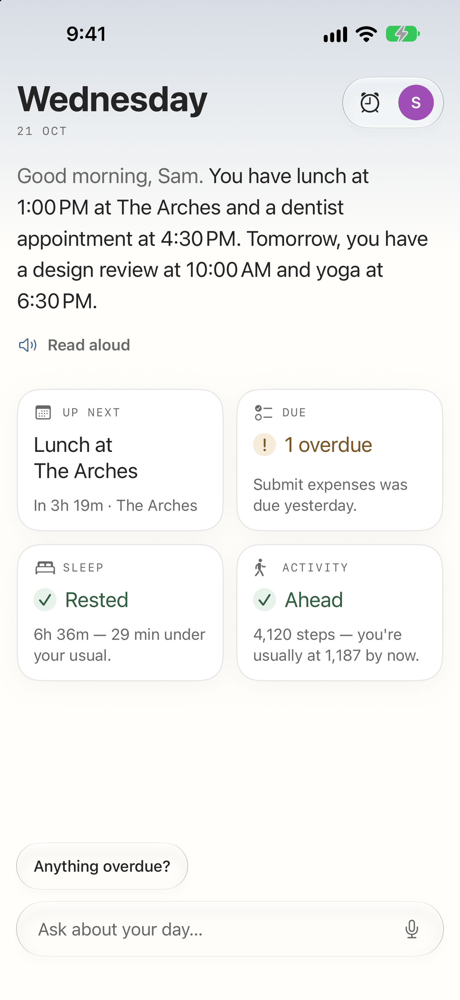
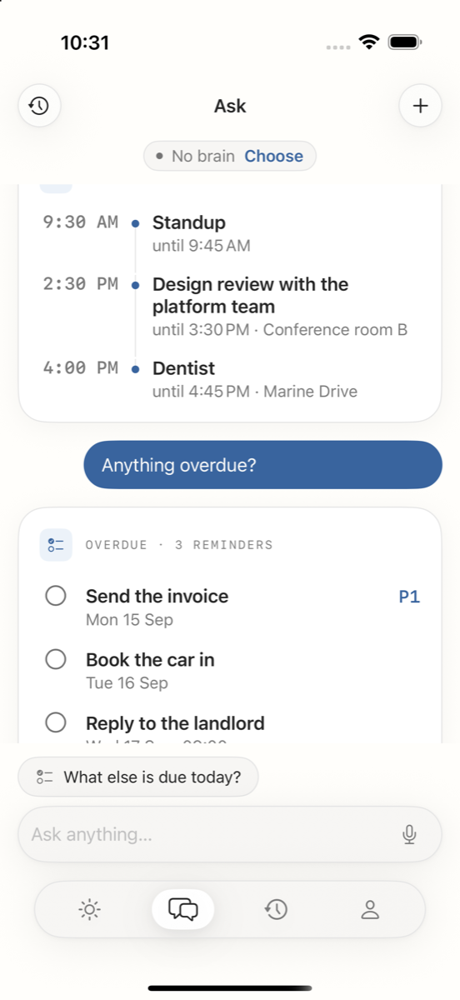
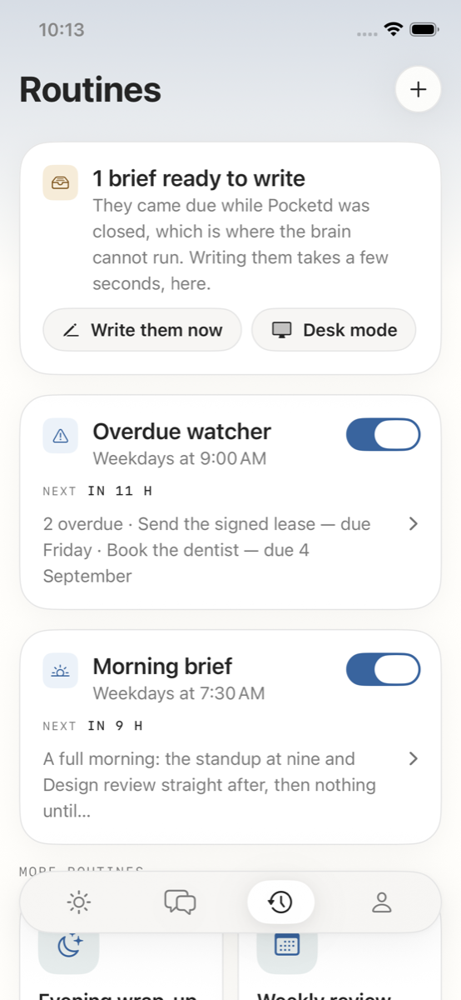
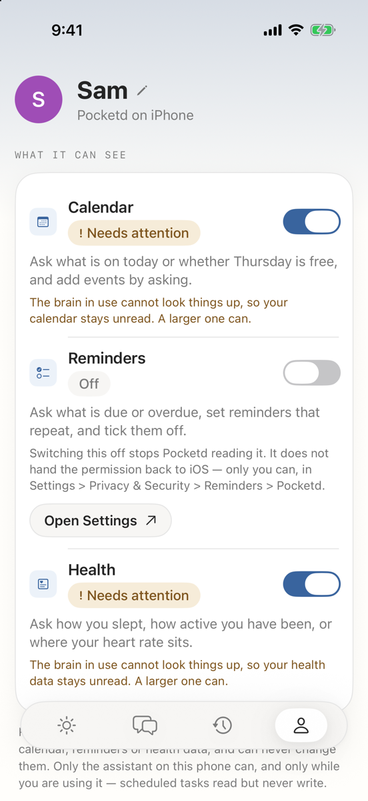
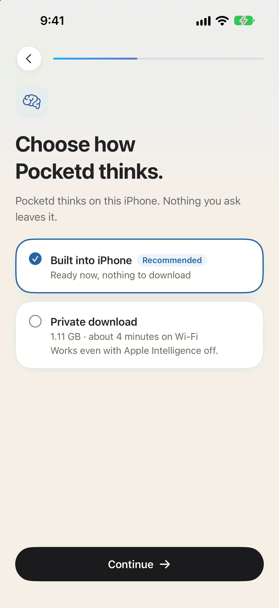
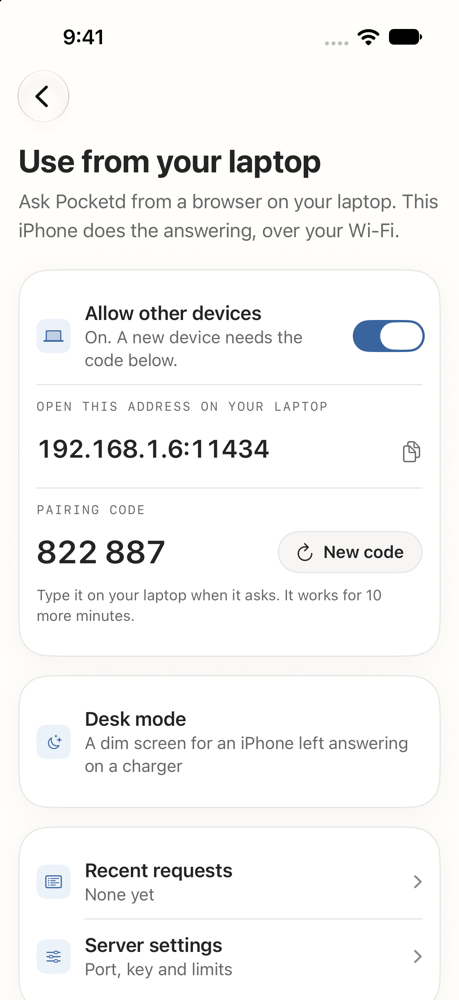

# pocketd

[](https://github.com/dheerajjha/pocketd/actions/workflows/ci.yml)
[](LICENSE)
[](Package.swift)
[](project.yml)

`pocketd` is an assistant that lives on your iPhone. It reads your calendar,
your reminders and your health data on the device, and writes you a short
brief each morning — a paragraph about your actual day, not a dashboard. Ask
it what's next, what's overdue, or how you slept, by typing, by holding the
mic button, or from Control Center. Tell it to set a reminder or add an event
and it does. Nothing you say and nothing it reads ever leaves the phone.



Four tiles under the brief show what's next, what's due, how you slept and how
many steps you've taken, each with a plain footnote against your own usual
rather than a national average. A Home Screen widget carries the same brief a
tap away, with no need to open the app at all.

## Ask

Ask is the conversation: type a question, or hold the mic button and speak it.
Speech recognition runs on the device — `requiresOnDeviceRecognition` is set
once and never unset — so on a phone or in a locale where that isn't
available, the mic button hides itself rather than quietly sending your voice
to a server. An answer that touches your calendar, reminders or health comes
back as a card instead of a wall of text: a timeline of events, a checklist of
reminders you can tick off without leaving the bubble, a small grid of health
numbers. If a question needs an ability that's switched off, Ask offers to
turn it on right there rather than answering as though it doesn't exist.



## Routines

Routines are what runs on its own. Tap a template to set up a morning brief,
an evening wrap-up, a weekly review, or a watcher for reminders that have
slipped past their date — each one an ordinary scheduled task from the moment
it's created, editable like anything you built by hand. A watcher needs no
model and no GPU: it's a deterministic read over your calendar or reminders
that can run to completion in the background, so it still fires days after you
last opened the app. Every card shows its schedule in a sentence, when it runs
next, and a preview of what it produced last time.



## You

You is the profile: what the assistant can see — Calendar, Reminders, Health,
each its own row and its own switch — its "brain" (which model is loaded, and
a search across Hugging Face for another), other devices (the same server
pocketd has always run, now one row instead of one tab), and privacy, which
walks through what leaves the phone screen by screen. Notifications, how the
brain behaves, diagnostics and the rest of Settings live here too.



## First run

First run downloads a model sized for your phone — it checks the phone's RAM
and recommends one that fits, instead of listing all of them — asks once each
for Calendar, Reminders and Health with a plain sentence about why, asks what
to call you, and sets a time for the morning brief. About two minutes, and
Today has something real to read by the time it's done.



## Why this exists

Every local-LLM app for iOS is a chat window. The model is right there, running
on hardware you own, and it can only be reached by the app that loaded it. The
most-requested feature on the leading open-source iOS client has been an HTTP
endpoint since [2024](https://github.com/a-ghorbani/pocketpal-ai/issues/203) and
is still open. The App Store option that does expose one is built on Apple
Intelligence, so it needs an iPhone 15 Pro or newer and refuses to run on
anything older.

`pocketd` is the other approach: llama.cpp, GGUF weights, and a real HTTP
server, on any device that can run iOS 18.

## Install

Requires Xcode 26 and [XcodeGen](https://github.com/yonaskolb/XcodeGen)
(`brew install xcodegen`). The `.xcodeproj` is generated, not committed.

```bash
git clone https://github.com/dheerajjha/pocketd
cd pocketd
make app          # generates Pocketd.xcodeproj
open Pocketd.xcodeproj
```

Set your team in Signing & Capabilities, then run on a device. A free Apple
developer account works; the provisioning profile expires after seven days and
you re-sign.

## Also, a server for your laptop

`pocketd` turns an iPhone into an inference server too. Load a model, press
Start, and every device on your Wi-Fi can talk to it through the OpenAI and
Ollama APIs they already speak — no account, and not one prompt or reply
leaving your network.

```bash
curl http://192.168.1.42:11434/v1/chat/completions \
  -H "Content-Type: application/json" \
  -H "Authorization: Bearer pk-…" \
  -d '{"model":"gemma-4-e2b","messages":[{"role":"user","content":"hello"}]}'
```

That is a phone answering. The port is Ollama's default on purpose: a client
already pointed at a desktop Ollama needs its host changed and nothing else.



## Chat from your laptop, with nothing installed

The phone already runs a web server, so it serves the client too. Open its
address in a browser and you get a chat window — streaming, model picker,
system prompt, stop button, history kept locally, tokens per second per reply.
No Docker, no account, no extension.

The page asks once for the six digits shown on the phone and remembers the key.
`/setup` has the same handshake and hands back ready-to-paste configs for curl,
Continue, opencode, the OpenAI SDKs, Open WebUI and Aider.

## It can see

Load a vision model and send it a picture — from the chat page, or as an OpenAI
`image_url` content part, or in Ollama's `images` array. The attach button only
appears for a model that can actually see; models that can are marked `◉`.

Verified on a physical iPhone 14: a solid green image comes back "Green.", a
solid yellow one "Yellow." — a control run, because a half-red-half-blue image
answered "Blue." and one colour out of two proves nothing on its own.

## What you can point at it

| Client | Works via | Configuration |
| --- | --- | --- |
| `curl`, `httpie` | OpenAI | Base URL + bearer token |
| OpenAI Python/JS SDK | OpenAI | `base_url="http://<phone>:11434/v1"` |
| Open WebUI | Ollama | Add an Ollama connection |
| Continue, Cline, Aider | OpenAI | Custom provider, any model id from `/v1/models` |
| LangChain, LlamaIndex | OpenAI | `ChatOpenAI(base_url=…)` |
| Anything Ollama-shaped | Ollama | Change the host, keep the port |

## API

| Endpoint | Dialect | Notes |
| --- | --- | --- |
| `GET /v1/models` | OpenAI | Installed models, not the whole catalogue |
| `POST /v1/chat/completions` | OpenAI | `stream: true` yields SSE, terminated by `[DONE]` |
| `POST /v1/completions` | OpenAI | Lifted into a single user turn |
| `GET /api/tags` | Ollama | |
| `POST /api/chat` | Ollama | Streams NDJSON, and streams **by default** |
| `POST /api/generate` | Ollama | |
| `POST /api/show` | Ollama | |
| `GET /api/version` | Ollama | Clients version-gate on this |
| `POST /api/pull` | Ollama | Pull a catalogue model onto the phone, streaming progress |
| `GET /api/catalogue` | — | What could be pulled, versus what is installed |
| `GET /api/search?q=` | — | Search Hugging Face for GGUF repositories |
| `GET /api/search/files?repo=` | — | Files in a repository, with real sizes and a fit verdict |
| `POST /api/models/add` | — | Pull any Hugging Face GGUF, not just a catalogue entry |
| `GET /health` | — | Unauthenticated, so a client can probe reachability |

Requests are authenticated with `Authorization: Bearer <key>` or `X-API-Key`.
Errors come back in the dialect you asked in: OpenAI's nested `{"error":{…}}`
or Ollama's flat `{"error":"…"}`, because a client fed the wrong one reports
"unknown error" and hides the reason.

## Desk mode

Reachable from You › Other devices. The honest instruction is to keep the app
on screen, which otherwise means an iPhone at full brightness for hours. Desk
mode dims to what is worth reading across a desk and drifts it slowly so no
pixel holds a colour — and because the display draws from the same thermal
budget as the GPU, a dark screen is worth real tokens per second on a device
already close to throttling.

## Any model, searched from your laptop

The catalogue is eight models known to load on a phone. It is the right default
and the wrong ceiling, so there is a `+`: search Hugging Face, see every GGUF in
a repository with its real byte size and whether it fits *this* device, and pull
it.

The searching happens over HTTP as well as in the app, which no other local-LLM
iOS app can offer because none of them is a server. Choosing a model means
typing a repository name and comparing quantisations — that is laptop work, and
doing it on a phone keyboard is the reason nobody does it twice.

```bash
curl "http://192.168.1.31:11434/api/search?q=smollm" -H "Authorization: Bearer pk-…"
curl "http://192.168.1.31:11434/api/search/files?repo=ggml-org/SmolVLM-500M-Instruct-GGUF" -H …
#   SmolVLM-500M-Instruct-Q8_0.gguf   436.8 MB  Q8_0  comfortable
#   mmproj-SmolVLM-500M-Instruct-Q8_0.gguf  108.8 MB  projector

curl -X POST http://192.168.1.31:11434/api/models/add -H … \
  -d '{"repo":"unsloth/SmolLM2-135M-Instruct-GGUF","filename":"SmolLM2-135M-Instruct-Q4_K_M.gguf"}'
```

A vision model's projector is paired automatically, because one downloaded
without it loads and then cannot see — which is the confusing failure rather
than the obvious one.

## Which models actually fit

An iPhone 14 has 6 GB of RAM and iOS lets one app touch roughly 45% of it —
about 58% with the `com.apple.developer.kernel.increased-memory-limit`
entitlement this app ships. Brain, under You, labels every model against that
budget and makes you confirm a download that will not fit, with the two
numbers on screen, rather than letting you find out after 2 GB of bandwidth.

Every size below is the real `Content-Length` of the file, checked by
`scripts/verify-catalogue.sh`, not a number inferred from the parameter count.

The badge is that arithmetic and nothing else — RAM times the fraction — so it
does not move while you use the app. It deliberately ignores how much memory is
free at this instant, because that number falls by the size of whatever is
loaded: a verdict computed from it labelled the running model too large to run.
"How much room is there right now" is a separate signal with separate words, and
its advice is to unload rather than to choose differently. In the simulator the
numbers describe your Mac: llama.cpp runs on the CPU there and the app process
gets roughly 722 MB, so only models under 1 GB are reported as fitting.

| Model | File | iPhone 14 (6 GB) | iPhone 16 Pro (8 GB) |
| --- | --- | --- | --- |
| SmolLM2 360M | 0.39 GB | Fits | Fits |
| SmolVLM 500M + projector | 0.55 GB | Fits | Fits |
| Llama 3.2 1B | 0.81 GB | Fits | Fits |
| Qwen3 1.7B | 1.11 GB | Fits | Fits |
| Llama 3.2 3B | 2.02 GB | Tight | Fits |
| Qwen3 4B | 2.50 GB | Needs the entitlement | Fits |
| Gemma 3 4B + projector | 3.34 GB | Too large | Tight |
| Gemma 4 E2B | 3.11 GB | Too large | Tight |

Gemma 4 E2B is the one that catches people out, and it caught me out. "E2B"
means two billion *effective* parameters — that describes the compute, not the
weights. It is a MatFormer, the file carries the full nested model, and Q4_K_M
is 3.1 GB rather than the ~1.8 GB the name suggests. It does not fit a 6 GB
phone even with the entitlement.

Expect roughly 15–25 tok/s for the 2B class on an A15, dropping to single
digits at 3–4B. The `128K` context Gemma 4 advertises is real for the weights
and not for the device: the KV cache is what exhausts a phone, so the server
caps context separately and defaults to 4096.

## What iOS makes hard

These are not bugs, and pretending otherwise would waste your afternoon.

- **A backgrounded app is an offline server.** iOS closes the listening socket
  when the app suspends. `pocketd` re-establishes it on every foreground and
  keeps the screen awake while serving, but the phone has to stay on Pocketd.
- **Thermals and battery.** Sustained generation throttles a phone within
  minutes. Rather than pretending otherwise, the server watches
  `thermalState` and the battery and answers `503` with a reason and a
  `Retry-After` — `device_thermal` recovers in about a minute, `device_battery`
  in about five. It keeps listening while throttled, because a refused
  connection looks like the phone has gone away and a refused request does not.
  Recovery needs more than crossing back over the line, or a device sitting at
  the boundary flaps every few seconds.
- **Local Network permission** is requested on first start. Deny it and the
  socket accepts nothing from other devices, silently.
- **DHCP moves the address** — so the phone publishes itself over Bonjour as
  `_pocketd._tcp` and `_ollama._tcp`, and the TXT record carries the version,
  the loaded model, whether a key is required, and which APIs it speaks. A
  client that browses never needs an address at all:

  ```
  $ dns-sd -B _pocketd._tcp local.
  Add  ...  _pocketd._tcp.  iPhone 17

  $ dns-sd -L "iPhone 17" _pocketd._tcp local.
  ... can be reached at Ranjus-MacBook-Pro.local.:11434
  version=0.1.0 api=openai,ollama auth=required model=smollm2-360m
  ```
- **Sampling costs a reload.** llama.cpp binds its sampler to the context, so
  honouring a changed `temperature`, `top_p`, `top_k`, `repeat_penalty` or
  `seed` means rebuilding it. pocketd does that only when the values differ
  from the resident ones, so repeated requests at the same settings cost
  nothing. An explicit `seed` always rebuilds, because that is the only way it
  reproduces. `frequency_penalty`, `presence_penalty` and `min_p` are refused
  with a 400 naming the field rather than accepted and ignored. `max_tokens`
  and `stop` are enforced by the server itself. The defaults every request
  inherits are in Settings.
- **Token counts are estimates.** `usage` is derived from a 4-characters-per-token
  approximation, not the model's tokenizer. Do not bill anyone against it.
- **Oversized prompts are refused, not truncated.** llama.cpp does not fail
  gracefully on a prompt past its batch — it raises an assertion and the process
  dies. So the server refuses with a 413 before the engine sees it, using a
  deliberately pessimistic estimate. A prompt near the limit may be refused
  even though it would have fit.
- **One generation at a time.** A phone has one GPU. A second concurrent request
  gets a 503 with `Retry-After` rather than being queued behind the first.
- **Vision does not run on the Simulator.** The projector's tensors go through
  Metal, and `MTLSimDevice newBufferWithLength:` raises SIGTRAP loading them —
  it takes the process down rather than failing. LocalLLMClient hardcodes
  `use_gpu = true` for the projector at `package` scope, so it cannot be turned
  off from here. The app refuses to load a vision model on a simulator instead
  of crashing. Use a device.
- **Voice does not work in the Simulator either.** On-device speech
  recognition doesn't exist there; `VoiceInput.isSupported` reports `false`
  and the mic button hides itself instead of pretending to listen. Use a
  device.
- **Client-supplied tools are not implemented.** `AnyLLMTool` in the pinned
  dependency only accepts a compile-time schema, so an agent sending its own
  tool definitions over HTTP cannot be served. Tools we define ourselves are a
  different matter and are the next thing.

## Verified

Run end to end on a physical **iPhone 14** (iOS 26.5) and on an iPhone 17
simulator, with real SmolLM2 360M weights and real llama.cpp:

- **29.4 tok/s** on the iPhone 14 with Metal — 200 tokens in 6.8s. The same
  build on the simulator, which is CPU-only, manages 5.6.
- `opencode` configured against the phone answers a prompt end to end
- the browser chat client streams at 20.6 chunks/s

- 386 MB downloaded in under 20 seconds, loaded, served
- reachable from the host Mac at the phone's LAN address
- `scripts/smoke.sh`: 38/38, including a 600-token buffered completion, a
  concurrent request correctly refused, an abandoned stream releasing its slot,
  and a 20,000-word prompt refused with a 413 instead of killing the process
- request log reporting live throughput per client

Three of those checks exist because the feature was broken and shipping when it
was written. The package suite is 1,026 tests and needs no simulator.

## Repository layout

```
Sources/PocketdKit/      the server, the wire formats, the model store
  Inference/             InferenceEngine protocol — the seam
  Models/                catalogue, downloads, device memory budget
  Server/                lifecycle, routes, SSE and NDJSON streaming
  Brief/                 the daily brief: snapshot, prompt, cache, widget mirror
Tests/PocketdKitTests/   1,026 tests, no simulator, no GPU
scripts/smoke.sh         probes a RUNNING server the way a client would
App/Sources/             the SwiftUI app
  Design/                colour, type, spacing and the shared component set
  Views/                 Today/, Ask/, Routines/, You/, Onboarding/, Shell/
  State/Navigator.swift  which tab, which sheet, which hand-off is pending
  Speech/                on-device speech-to-text and read-aloud
  Inference/             llama.cpp adapter (LocalLLMClient)
App/Widgets/             TodayWidget.swift reads the brief the app mirrors for it
project.yml              XcodeGen spec; the .xcodeproj is generated
```

`PocketdKit` depends on an HTTP server and nothing else. The inference backend
enters through one protocol, which is why the entire API surface — routes, auth,
streaming, error shapes — is tested on a Linux-or-macOS runner in about a second
without compiling llama.cpp or booting a simulator. Swapping in MLX or Apple's
Foundation Models means writing one conformance, not touching the routes.

## Development

```bash
make test        # the package: fast, no simulator
./scripts/verify-catalogue.sh   # every model URL still resolves, sizes still right
make app         # regenerate the Xcode project
make build-sim   # compile the app target (slow: builds llama.cpp)
make smoke BASE=http://192.168.1.42:11434 KEY=pk-...   # probe a running server
scripts/sim-demo.sh <udid>      # seed a simulator with demo Calendar/Reminders (DEBUG only)
```

`make test` covers the routes against a mock engine. `make smoke` covers what it
cannot: a real model, a real device, and a real network hop. Read the base URL
and key off You › Other devices.

The simulator runs llama.cpp on the CPU. It is the right place to check that
things compile and the UI behaves, and useless for measuring tokens per second.

### Where the compatibility rules come from

`reference/sync.sh` shallow-clones the projects this one reads: Ollama and
llama.cpp for the two wire formats, and PocketPal, LLMFarm and fullmoon for the
iOS problems. The folder is git-ignored — they are other people's repositories
under their own licenses, read here and never vendored.

Almost every compatibility rule in this repository came from one of those
sources rather than a guess, and the tests say which:

| Rule | Source |
| --- | --- |
| `HEAD /`, `HEAD /api/tags`, `HEAD /api/version` | `ollama/server/routes.go` |
| `parent_model` and `families` always on the wire | `ollama/api/types.go` — no `omitempty` |
| Usage chunk carries an empty `choices` array | `llama.cpp/tools/server/server-task.cpp` |
| `NSAllowsLocalNetworking` in the app's ATS block | `pocketpal-ai/ios/PocketPal/Info.plist` |
| Warn on an oversized model instead of blocking | PocketPal's memory-warning dialog |
| Ship `increased-memory-limit` | all three iOS apps do |

## Contributing

By roughly how long it takes:

1. **A model in the catalogue** (~5 minutes) — add a `ModelRecord` to
   `ModelCatalog.swift` with a real size in bytes. The size is what the fit
   badge is computed from, so an estimate that is wrong by a gigabyte is worse
   than no entry.
2. **A client compatibility fix** (~30 minutes) — if a client refuses to talk
   to `pocketd`, the fix belongs in `Routes+OpenAI.swift` or `Routes+Ollama.swift`
   with a test that captures the exact shape the client wanted.
3. **A new backend** (~half a day) — conform to `InferenceEngine`. MLX and
   Foundation Models are both reachable through LocalLLMClient already.

Every route change needs a test that goes over real HTTP. `TestServer` boots a
listener on a kernel-assigned port; calling handlers directly would pass while
the SSE framing and the status codes were wrong, which is exactly the layer
third-party clients depend on.

## Privacy

[**dheerajjha.github.io/pocketd**](https://dheerajjha.github.io/pocketd/) — the
published policy, and the URL App Store Connect points at. It is
[`docs/index.html`](docs/index.html) in this repository: short, and checkable
against this source tree rather than taken on trust.

Two hosts are ever contacted. `huggingface.co`, to search for or download a
model. And `api.mixpanel.com`, which receives usage events — the app opened, a
model downloaded or loaded, a message sent, the server started, a client
answered, an ability switched on, a scheduled task run. They are on by default
and a switch in Settings turns them off; the complete list is
`AnalyticsEvent.swift`, which is twenty-eight cases long and is meant to be read
in a minute.

Voice works the same way. Holding the mic button asks for the microphone and
speech recognition, once each, and both stop the instant you let go.
Recognition runs on the device — `requiresOnDeviceRecognition` is set once and
never unset, so there is no fallback to a server recognizer — and nothing you
say is ever recorded or uploaded. Reading a brief or an answer back out loud
uses the same on-device voice synthesis as the rest of iOS.

What stays is the part worth promising. Inference is local and the HTTP server
only answers, so nothing you type and nothing the model says back is ever
transmitted. Health, calendar and reminder data are read on-device and are
refused to network callers — including the chat page the phone itself serves —
by the origin gate in `RequestOrigin.swift`. The assistant can also add events
and reminders — including repeating ones, as a native `EKRecurrenceRule` rather
than anything this app simulates — behind a second and stricter gate in the same
file:
`mayWritePersonalData` admits only the Ask tab, so a network client cannot
change anything and neither can a scheduled run, which reads at an hour when
nobody is watching and shares its context with calendar titles that strangers
wrote. No usage event can carry any of it
either: `AnalyticsSchema` is an allow-list of property names beside a list of
banned ones, and a test fails the build when an event names a prompt, a file, an
address or a health figure. There is no crash reporting and no account.

The page also spells out the parts that are less tidy: the Bonjour broadcast,
the hand-off to Safari, and the system pasteboard. The app's own Privacy
screen, in You, makes the same argument interactively, by walking the
container and accounting for every byte in it.

## License

MIT. See [LICENSE](LICENSE).
